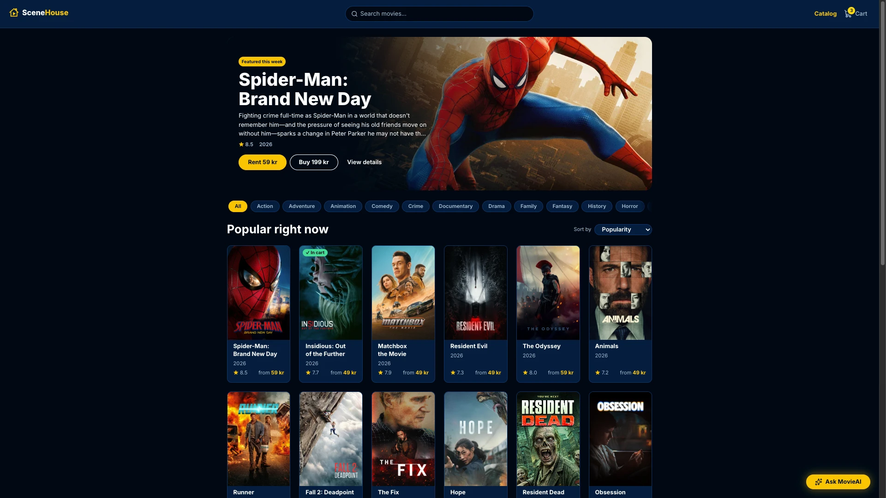
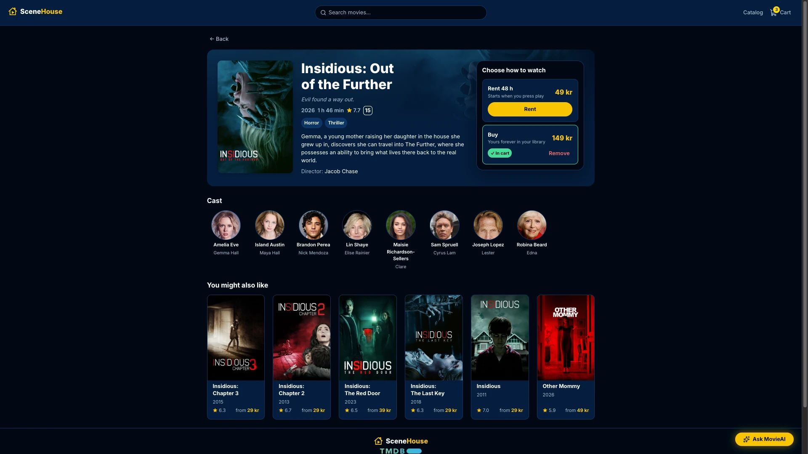
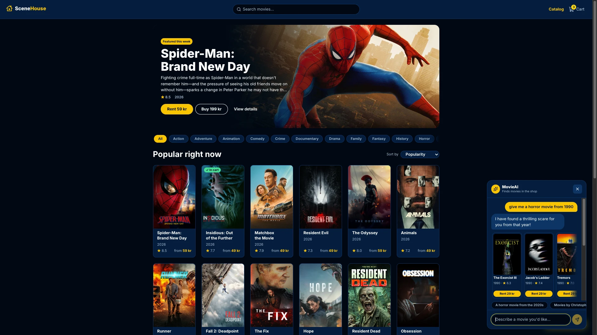
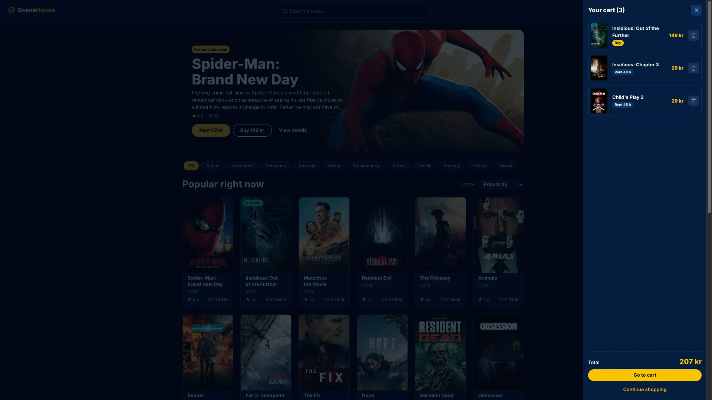
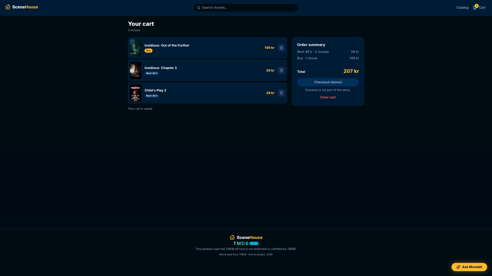
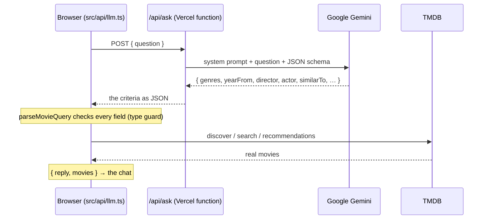
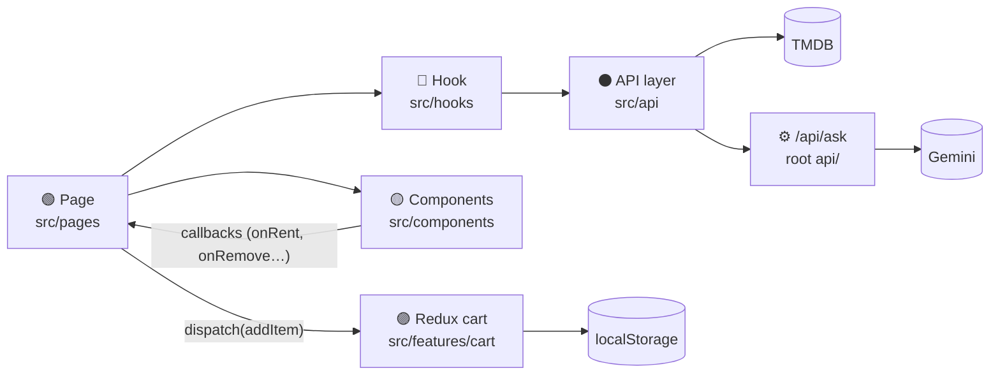
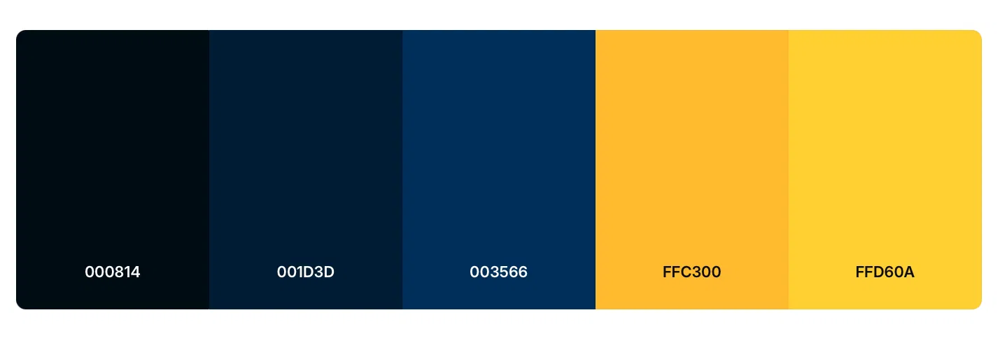

<p align="center">
  
</p>

<h1 align="center">SceneHouse</h1>

<p align="center">
  A web shop for digital movies — rent for 48 hours or buy to keep.<br>
  Live movie data from TMDB, and <strong>MovieAI</strong>: describe what you're in the mood for, get real movies back.
</p>

<p align="center">
  <a href="https://scenehouse-ochre.vercel.app"><strong>Live site</strong></a> ·
  <a href="#getting-started">Run it locally</a> ·
  <a href="#architecture">Architecture</a> ·
  <a href="#design-system">Design system</a>
</p>

<p align="center">
  <a href="https://github.com/PatrikNoordh/scenehouse/actions/workflows/ci.yml"></a>
  <a href="https://scenehouse-ochre.vercel.app"></a>
  
  
</p>

---

## Contents

- [Screenshots](#screenshots)
- [Features](#features)
- [How MovieAI works](#how-movieai-works)
- [Tech stack](#tech-stack)
- [Architecture](#architecture)
- [Project structure](#project-structure)
- [Design system](#design-system)
- [Security](#security)
- [Accessibility](#accessibility)
- [Getting started](#getting-started)
- [Scripts](#scripts)
- [Quality and CI](#quality-and-ci)
- [Key decisions and trade-offs](#key-decisions-and-trade-offs)
- [Conventions](#conventions)
- [Known limitations](#known-limitations)
- [Roadmap](#roadmap)
- [Credits and attribution](#credits-and-attribution)

---

## Screenshots

**Catalog** — featured hero, genre chips, sort and the movie grid


**Movie detail** — poster, facts, the "Choose how to watch" box, cast and recommendations


**MovieAI** — a question in plain words, answered with real movies that can be rented from the chat


| Cart drawer | Cart page |
|---|---|
|  |  |

---

## Features

**Browse**
- **Catalog** — a "Featured this week" hero and the most popular movies in a responsive grid, with "Load more"
- **Search** from the navbar on every page, **genre chips** and **sorting** (popularity, rating, release date)
- Filters live **in the URL** (`/?q=&genre=&sort=`), so Back, reload and shared links all restore the same results
- **Movie detail page** — backdrop, poster, age rating (Swedish, falling back to US), runtime, genres, cast, director and "You might also like"

**Buy**
- **Rent for 48 hours or buy** — one option per movie; choosing the other one replaces it
- **Cart** — navbar badge, slide-in drawer and a cart page with an order summary
- **The cart is saved** in `localStorage` and survives a reload
- Prices in **SEK**, based on the movie's age and rating (see [pricing rules](#pricing))

**MovieAI**
- A floating **"Ask MovieAI"** chat on every page: *"a feel-good comedy rated above 7"*, *"movies by Christopher Nolan"*, *"something like Interstellar"*
- Answers with **real, clickable TMDB movies** that can be rented straight from the chat
- The conversation is kept while you move between pages

**Everywhere**
- Every data view handles **loading, error (with "Try again"), empty and success**
- **Dark and light theme**, following the operating system
- **Responsive** from a 360 px phone to a wide desktop
- **Keyboard accessible**, with visible focus and screen-reader labels

---

## How MovieAI works

The language model **never picks the movies**. It only turns the visitor's words into search criteria; TMDB decides which movies exist. That is why MovieAI can't invent a film.



1. **`api/ask.ts`** (server) reads `LLM_API_KEY`, limits the question to 300 characters, and asks Gemini for **structured JSON** that must follow a schema. If a model is busy (429/503) it tries a lighter one.
2. **`src/api/llm.ts`** (browser) checks the JSON field by field, then picks one strategy: *similar to* → that movie's recommendations; a *title* → title search; otherwise TMDB's discover with genres, years, minimum rating, director and actor.
3. The chat shows the model's one-sentence reply plus up to six movie cards.

---

## Tech stack

| | Choice | Why |
|---|---|---|
| UI | **React 19** + **TypeScript** (strict) | Components and hooks; strict types catch null and shape errors before the browser does |
| Build | **Vite** | Instant dev server, small production bundle |
| Routing | **React Router** (`react-router`) | Real URLs for every page; filters in the query string |
| State | **Redux Toolkit** — the cart only | One global, persisted cart; everything else is local or server state |
| Styling | **CSS Modules** + design tokens | Scoped class names, one place for every colour and spacing value |
| Data | **TMDB API** | Live movie data, images, credits and recommendations |
| AI | **Google Gemini** via a Vercel function | Structured JSON output; the key stays on the server |
| Icons | **Lucide** (`lucide-react`) | Consistent icons as React components; only imported icons are bundled |
| Font | **Inter** (Google Fonts) | The typeface of the design |
| Quality | **ESLint** + **GitHub Actions** | Lint and type-checked build on every push and pull request |
| Hosting | **Vercel** | Deploys `main`; a preview link for every pull request; serverless functions in `/api` |

---

## Architecture

The code is organised in **layers**, and data flows **one way**:



| Layer | Folder | Rule |
|---|---|---|
| 🔷 Types | `src/types/` | Shapes of the app's data. No logic. |
| ⚫ API | `src/api/` | `fetch`, normalize, cache. No React. |
| ⚙️ Server | `api/` (root) | Vercel functions. The only place a secret key is read. |
| ⚪ Utils / config | `src/utils/`, `src/config.ts` | Pure functions and settings. No React, no fetch. |
| 🟣 Store | `src/app/`, `src/features/` | Redux — **the cart only**. |
| 🔵 Hooks | `src/hooks/` | State and effects; call the API layer; return data. |
| 🟢 Pages | `src/pages/` | One per route. Read the URL, use hooks, compose components. |
| 🟡 Components | `src/components/` | Presentational. Props in, JSX out, actions reported up. |

**Rules that follow from it**
- **Components never fetch.** A page gets data through a hook and passes it down as props.
- **TMDB's raw JSON is only known in `src/api/tmdbNormalize.ts`.** Everything else uses the app's own types — if TMDB changes, one file changes.
- **Data from outside is `unknown`** (TMDB, the LLM, `localStorage`) until a type guard or normalize function has checked it. No `any`, no `as` casts.
- **Components report, pages decide.** A card says *"Rent was clicked"*; the page dispatches the action.

**Two folders are called `api`**
| Folder | Runs | May hold a secret? |
|---|---|---|
| `api/` (root) | on Vercel's servers | **Yes** — `LLM_API_KEY` |
| `src/api/` | in the visitor's browser | **Never** |

Vercel turns every file in the root `api/` folder into a serverless function (`api/ask.ts` → `POST /api/ask`), so that name is fixed. The two folders are type-checked by two different TypeScript configs: `tsconfig.app.json` (browser) and `tsconfig.node.json` (server).

---

## Project structure

```
scenehouse/
├── api/
│   └── ask.ts                # ⚙️ POST /api/ask — Gemini, server side
├── docs/                     # logo, screenshots and palette images for this README
├── public/                   # favicon, placeholder image, TMDB logo
├── src/
│   ├── main.tsx              # entry — Redux Provider, router, global styles
│   ├── App.tsx               # route table
│   ├── config.ts             # language, currency and region settings
│   ├── routes.ts             # route paths — paths.movie(id)
│   ├── types/                # 🔷 tmdb.ts, movieAi.ts
│   ├── api/                  # ⚫ browser API layer
│   │   ├── tmdb.ts           #    entry point — the public TMDB requests
│   │   ├── tmdbClient.ts     #    fetch, API key, in-memory cache
│   │   ├── tmdbNormalize.ts  #    raw TMDB JSON → the app's types
│   │   ├── tmdbError.ts      #    TmdbError + readable messages
│   │   ├── tmdbImages.ts     #    image URLs
│   │   └── llm.ts            #    MovieAI — asks /api/ask, maps the answer to TMDB
│   ├── hooks/                # 🔵 useMovies, useMovieDetails, useGenres, useFeaturedMovie, useMovieAi
│   ├── app/                  # 🟣 Redux store + typed hooks
│   ├── features/cart/        # 🟣 cart slice — reducers, actions, selectors
│   ├── utils/                # ⚪ pricing, age rating, URL filters, type guards, localStorage
│   ├── pages/                # 🟢 CatalogPage, DetailPage, CartPage, NotFoundPage
│   ├── components/           # 🟡 Layout, Logo, SearchBar, MovieCard, CartDrawer, ChatWidget, …
│   └── styles/               # 🎨 tokens.css (design tokens) + global.css
├── vercel.json               # SPA rewrite — deep links survive a reload
└── .github/workflows/ci.yml  # lint + build on every push and pull request
```

Every page and component folder holds `Name.tsx` + `Name.module.css`.

---

## Design system

All colours, spacing, radii and shadows are **CSS custom properties** in [`src/styles/tokens.css`](src/styles/tokens.css). Component stylesheets never contain a hex value or a pixel spacing — so the light theme is just a second set of values for the same tokens.

### Logo

<p>
  
  &nbsp;
  
</p>

A house with a play button: *your home for movies*. In the app the mark is an inline SVG drawn in `currentColor`, so it is yellow in the dark theme and navy in the light theme without a second file.

### Colour palette



The brand palette is three navy blues (`#000814` · `#001D3D` · `#003566`) and two yellows (`#FFC300` · `#FFD60A`). Every token below is built from it:

| Token | Dark (default) | Light | Used for |
|---|---|---|---|
| `--color-bg` | `#000814` | `#F5F7FA` | Page background |
| `--color-surface` | `#001D3D` | `#FFFFFF` | Navbar, cards, panels, drawer, chat |
| `--color-surface-2` | `#003566` | `#E3EAF3` | Hover, chips, inputs |
| `--color-border` | `#003566` | `#E3EAF3` | Lines around cards and inputs |
| `--color-accent` | `#FFC300` | `#FFC300` | Primary buttons, stars, active chips |
| `--color-accent-hi` | `#FFD60A` | `#FFD60A` | Cart badge, focus ring, hover |
| `--color-on-accent` | `#000814` | `#000814` | Text on yellow |
| `--color-text` | `#FFFFFF` | `#000814` | Body text |
| `--color-text-muted` | `#A9B8CC` | `#4A5A70` | Secondary text |
| `--color-link` | `#FFC300` | `#003566` | Links, prices, the logo (yellow text fails contrast on white) |
| `--color-success` | `#3DDC97` | `#1FA97A` | "✓ In cart" |
| `--color-danger` | `#FF6B6B` | `#D64545` | Errors, remove buttons |

The theme follows the operating system (`prefers-color-scheme`); dark is the default.

### Typography, spacing and shape

| | Tokens |
|---|---|
| Font | `--font-body`: Inter, system-ui, sans-serif · weights 400–800 |
| Spacing (8 px grid) | `--space-xs` 4 · `--space-sm` 8 · `--space-md` 16 · `--space-lg` 24 · `--space-xl` 32 |
| Radius | `--radius-sm` 8 · `--radius-md` 12 · `--radius-lg` 20 · `--radius-pill` 999 |
| Elevation | `--shadow-card` · `--shadow-panel` · `--shadow-glow` (weaker in the light theme) |

Layouts are **mobile-first**: base styles are the phone layout, extended at `768px` and `1200px`.

---

## Security

| Variable | Where it lives | Reaches the browser? |
|---|---|---|
| `VITE_TMDB_KEY` | `.env` + Vercel | **Yes** — every `VITE_` variable is built into the JavaScript bundle. Accepted: TMDB's key is free and read-only. |
| `LLM_API_KEY` | `.env` + Vercel, **no `VITE_` prefix** | **No** — only read by `api/ask.ts` on the server, sent to Google in a header (never in a URL) |

- `.env` is gitignored; `.env.example` (empty values) is committed.
- The browser only ever talks to `/api/ask`, never to Gemini directly.
- The server limits questions to 300 characters, and the browser checks the model's JSON again before using it — *never trust, always verify*.
- No key and no request URL containing a key is ever logged.

---

## Accessibility

- Real `<button>` and `<a>` elements everywhere — no clickable `<div>`s
- Visible focus ring (`--color-accent-hi`) on every interactive element
- The cart drawer and the MovieAI chat are native `<dialog>` elements: **Esc** closes them, focus is trapped inside, and the chat moves focus to its input
- Genre chips are toggle buttons with `aria-pressed`; icon-only buttons have an `aria-label` (*"Remove Edge of Orbit"*, *"Cart, 2 items"*)
- Decorative images and icons have an empty `alt` or `aria-hidden`
- New MovieAI answers are announced by an `aria-live` region
- `prefers-reduced-motion` turns animations off

---

## Getting started

### 1. Requirements

- [Node.js](https://nodejs.org) 24 (the version CI uses) and npm
- A free [TMDB](https://www.themoviedb.org/signup) account — for the movie data
- A free [Google AI Studio](https://aistudio.google.com) API key — only for MovieAI

### 2. Clone and install

```bash
git clone https://github.com/PatrikNoordh/scenehouse.git
cd scenehouse
npm install
```

### 3. Add your keys

```bash
cp .env.example .env
```

```env
VITE_TMDB_KEY=your_tmdb_api_key     # TMDB → Settings → API → "API Key" (the short one)
LLM_API_KEY=your_gemini_api_key     # Google AI Studio → Get API key — no VITE_ prefix!
VITE_YOUTUBE_KEY=                   # not used yet
```

### 4. Run it

| Command | Use it when |
|---|---|
| `npm run dev` → http://localhost:5173 | Working on the shop. MovieAI answers with an error, because Vite can't run the `api/` function. |
| `npx vercel dev` → http://localhost:3000 | Working on MovieAI. Runs Vite **and** `api/ask.ts`. The first time it asks you to log in and link the project. |

Restart the dev server after changing `.env` — it is only read at startup.

### 5. Deploying

The repository is connected to Vercel: every push to `main` deploys the live site, and every pull request gets a preview link. Set `VITE_TMDB_KEY` and `LLM_API_KEY` under **Settings → Environment Variables** for Production and Preview — a new variable only applies to new deployments.

---

## Scripts

| Command | What it does |
|---|---|
| `npm run dev` | Dev server with hot reload |
| `npm run build` | Type check (`tsc -b`), then a production build into `dist/` |
| `npm run preview` | Serve the production build locally |
| `npm run lint` | ESLint |

---

## Quality and CI

[`.github/workflows/ci.yml`](.github/workflows/ci.yml) runs on every push and pull request: `npm ci` → `npm run lint` → `npm run build` (which includes the TypeScript check). A pull request is only merged when CI is green.

- **TypeScript strict mode**, no `any`, no `as` casts to silence errors
- **ESLint** with `eslint-plugin-react-hooks` — including the rule that forbids setting state at the top of an effect
- Every function, hook and component has a short JSDoc comment explaining *why*

---

## Key decisions and trade-offs

| Decision | Why | Trade-off |
|---|---|---|
| **Redux only for the cart** | The cart is the one piece of global state that must survive navigation and reloads | Movie data lives in hooks + an in-memory cache, not in the store |
| **Filters in the URL** | Back, reload and shared links restore the same results | Every filter change is a new history entry |
| **One detail request** (`append_to_response`) | Details, credits, videos, age ratings and recommendations in a single call | A larger response |
| **In-memory TMDB cache** | Instant Back and revisits; only successful answers are stored | Gone on reload — on purpose: TMDB's terms forbid long-term storage |
| **The LLM returns criteria, not movies** | Every result exists in TMDB and links to a real page | Questions TMDB can't filter on (e.g. a mood) are approximated with genres and ratings |
| **A server function for the LLM** | The key never reaches the browser | MovieAI needs `vercel dev` locally |
| **Prices calculated, not stored** | TMDB has no prices; the same movie always gets the same price | Prices are fictional |
| **Native `<dialog>`** for the drawer and chat | Esc, focus trap and backdrop come from the browser | Styling a closed dialog needs care (no `display` on the dialog itself) |

### Pricing

| Age of the movie | Rent 48 h | Buy |
|---|---|---|
| Released within a year, or unreleased | 49 kr | 149 kr |
| 1–5 years old | 39 kr | 99 kr |
| Older than 5 years | 29 kr | 79 kr |
| No release date | 39 kr | 99 kr |

Rated 8.0 or higher: rent +10 kr, buy +50 kr. Rent is always cheaper than buy. The rules live in [`src/utils/pricing.ts`](src/utils/pricing.ts), and every price on screen goes through `formatPrice()`.

---

## Conventions

- **One ticket = one branch = one pull request** into `main`, with `Closes #N`
- **Branches:** `type/SH-NNN-short-description` — e.g. `feat/SH-016-movieai-chat-widget`
- **Commits:** `type [SH-NNN] Present tense description` — e.g. `feat [SH-016] Add the MovieAI floating chat widget`
- **Types:** `feat` · `fix` · `style` · `refactor` · `test` · `chore` · `docs`
- Tickets are prioritised with MoSCoW (must / should / could) on the [GitHub issues](https://github.com/PatrikNoordh/scenehouse/issues)

---

## Known limitations

- **No checkout or payment** — the cart is the end of the flow.
- **Prices are fictional** — calculated from age and rating.
- **English only**, prices in SEK.
- **The TMDB key is visible in the browser** — accepted for a free, read-only key (see [Security](#security)).
- **MovieAI depends on Gemini's free tier** — when every model is busy, the chat asks you to try again.
- **No trailers yet** — the YouTube integration is planned.

---

## Roadmap

| | Ticket |
|---|---|
| Tests | Unit tests for pricing, age rating, the cart slice and the TMDB normalizers (Vitest) |
| Video | YouTube trailer with live statistics; "More videos" search |
| Polish | Accessibility audit (Lighthouse ≥ 90); "Added to cart" toast; sticky mobile Rent/Buy bar |
| Extras | Swedish language · currency switcher with live rates · "Also available on" streaming providers · a serverless proxy for the TMDB key · an own RAG backend for MovieAI |

---

## Credits and attribution


This product uses the TMDB API but is not endorsed or certified by TMDB.
Movie data and images are provided by [The Movie Database (TMDB)](https://www.themoviedb.org).

- MovieAI uses [Google Gemini](https://ai.google.dev).
- Icons by [Lucide](https://lucide.dev) (ISC licence).
- Drag scrolling by [react-indiana-drag-scroll](https://github.com/norserium/react-indiana-drag-scroll) (MIT).
- Typeface [Inter](https://rsms.me/inter/) by Rasmus Andersson.

SceneHouse is a school project (2026) by [Patrik Noordh](https://github.com/PatrikNoordh). The movies, prices and cart are for demonstration only.
